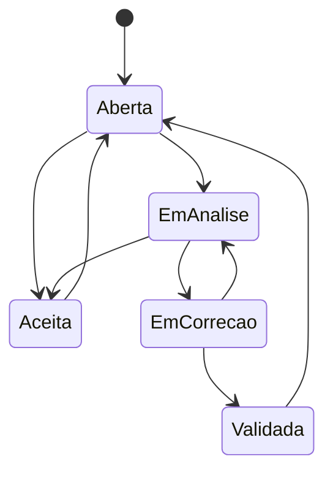

# VulnTrack

Painel demonstrativo para acompanhar vulnerabilidades, prazos e planos de tratamento. Feito para portfólio com dados totalmente fictícios.


## O que o projeto demonstra

- API REST em Python com FastAPI e persistência SQLite.
- Painel responsivo com resumo, busca, filtros e exportação CSV.
- Cadastro de vulnerabilidades com validação de campos e faixa CVSS.
- Fluxo de status com transições permitidas e tratamento de conflitos.
- Container sem usuário privilegiado, filesystem somente leitura e porta local.
- Testes automatizados e validação no GitHub Actions.
- Interface sem dependência de fontes, imagens ou scripts externos.

## Documentação

Consulte [docs/DOCUMENTACAO.md](docs/DOCUMENTACAO.md) para arquitetura, regras de negócio, endpoints, validação e limites de segurança.

## Pré-requisitos

- Python 3.12 ou Docker com Docker Compose v2.

## Executar com Docker

```bash
docker compose up --build
```

Abra [http://localhost:8000](http://localhost:8000). A API interativa fica em [http://localhost:8000/docs](http://localhost:8000/docs) e o health check em `/health`.

O Compose vincula a aplicação a `127.0.0.1` e persiste o banco no volume `vulntrack-data`. Para encerrar, execute `docker compose down`. Para apagar também os dados locais, execute `docker compose down -v`.

## Executar sem Docker

```bash
python -m venv .venv
# Linux/macOS: source .venv/bin/activate
# Windows PowerShell: .venv\Scripts\Activate.ps1
pip install -r requirements.txt
uvicorn app:app --reload
```

A aplicação cria o banco `data/vulntrack.db` e carrega registros de demonstração na primeira inicialização. Para apontar para outro caminho, defina a variável `VULNTRACK_DB`.

## Validar

```bash
pip install -r requirements.txt
python -m unittest discover -s tests -v
```

Os testes verificam carga dos dados demonstrativos, resumo, cadastro, busca, validação de CVE, regras de transição e exclusão.

## API principal

| Método | Rota | Descrição |
| --- | --- | --- |
| `GET` | `/health` | Verifica se a API responde |
| `GET` | `/api/summary` | Retorna os indicadores do painel |
| `GET` | `/api/vulnerabilities` | Lista e filtra registros por status, criticidade ou busca |
| `POST` | `/api/vulnerabilities` | Cadastra uma vulnerabilidade |
| `PATCH` | `/api/vulnerabilities/{id}/status` | Atualiza o status conforme o fluxo permitido |
| `DELETE` | `/api/vulnerabilities/{id}` | Exclui um registro demonstrativo |

### Fluxo de status



Transições não permitidas retornam `409 Conflict`.

## Segurança e limites

- Todos os registros iniciais são fictícios. Os identificadores `CVE-2099-*` são marcadores de demonstração e não indicam vulnerabilidades reais.
- Não use nomes de hosts, endereços, evidências ou dados da empresa em uma cópia pública.
- A aplicação não tem autenticação, autorização por perfil, trilha de auditoria imutável ou integração com scanners; destina-se a execução local e apresentação de portfólio.
- O SQLite atende ao laboratório de instância única. Uma evolução para uso compartilhado exigiria, entre outros controles, autenticação, autorização, PostgreSQL, backup, auditoria, gestão de segredos e revisão de segurança.
- A API aceita texto de plano de tratamento e valida limites de tamanho. Não há anexos nem upload de arquivos.
- `docker-compose.yml` publica a porta apenas no loopback. Não exponha o serviço diretamente à internet.

## Estrutura

```text
app.py                     API, regras de negócio e banco SQLite
static/                    Painel HTML, CSS e JavaScript
tests/test_app.py           Testes automatizados da API
Dockerfile                  Imagem com usuário sem privilégios
docker-compose.yml          Execução local com controles básicos
.github/workflows/validate.yml  Validação contínua
```

## Próximas evoluções

1. Adicionar edição dos metadados e histórico de mudanças.
2. Implementar autenticação e perfis com auditoria.
3. Migrar para PostgreSQL com Alembic caso exista necessidade multiusuário.
4. Adicionar importação controlada de inventários e integração opcional com fontes CVE públicas.
5. Incluir testes de integração em container e backup/restauração.

## Autor

Gabriel Affonso Cunha — projeto de portfólio em desenvolvimento de APIs, segurança e infraestrutura.
